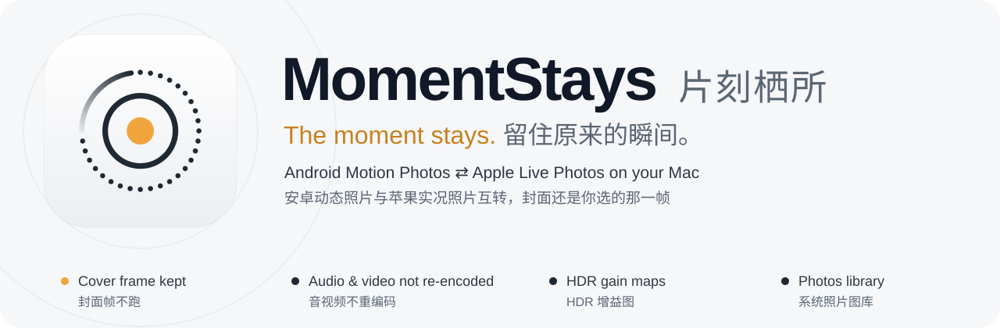

<p align="center">
  
</p>

<p align="center">
  <a href="README.md">English</a> · <strong>简体中文</strong>
</p>

<p align="center">
  <strong>macOS 12+ · 原生 SwiftUI · 本地处理 · 版本 1.5.1</strong>
</p>

# 留刻（MomentStays）— 安卓动态照片转苹果实况照片（Live Photo）工具

把安卓手机的动态照片转换成 iPhone 实况照片（Apple Live Photo），也可以把实况照片反向转回安卓动态照片。支持三星动态照片、小米动态照片、Google（Pixel）动态照片，以及华为/荣耀、OPPO、vivo 的动态照片格式，以 JPEG 为主，另支持已验证的三星 HEIC 布局。

转换时保留你选定的封面帧（封面时间）、原始视频和音频（只重新封装、不重新编码）和 Ultra HDR 增益图，转换结果可以直接导入 Mac 的「照片」图库。全部处理都在本机完成，不上传任何照片。

常见使用场景：换手机时把安卓动态照片导入 iPhone；把三星/小米动态照片转成实况照片存进苹果图库；在 Mac 上批量把 Motion Photo 转成 Live Photo；把 iPhone 实况照片转回安卓动态照片发给安卓手机查看。

<p align="center">
  
  
  
</p>

> **欢迎反馈：** 试过之后发现失败或结果不对？请[提交 issue](https://github.com/LinoFish/MomentStays/issues)，说明来源设备与格式、转换方向和 App 版本，样片请先抹除敏感信息。详见下文[反馈](#反馈)。

**下载：** 在 [Releases](https://github.com/LinoFish/MomentStays/releases) 获取最新 DMG/ZIP，也可以按下方说明从源码构建。

在 Android 动态照片与 Apple Live Photo 之间转换，留住你选定的封面瞬间。复用原始音视频，保留支持的图像与 HDR 数据，并将转换后的实况照片直接送回系统图库。

[构建与运行](#构建与运行) · [与系统图库互通](#与系统图库互通) · [保留哪些信息](#保留哪些信息) · [使用手册](docs/USER_GUIDE.zh-CN.md) · [项目文档](docs/README.md)

**开源协议：[GPL-3.0-only](LICENSE)** · Copyright © 2026 Lino

## 反馈

欢迎提交反馈。如果转换失败、或者结果不对，请[提交 issue](https://github.com/LinoFish/MomentStays/issues)，并说明：来源设备与格式、转换方向、App 版本、你期望的结果、实际得到的结果。

如果能提供可复现失败的样片，请先抹除敏感信息：用不含个人内容的照片，并去掉位置等私人元数据再上传。能复现问题的最小样片，比一整套个人相册更有用。

## 留住原来的瞬间

| | 留刻保留的内容 |
| --- | --- |
| **选定的封面位置** | 读取源封面时间戳，映射实际视频帧，并写入 Live Photo 封面定时标记。 |
| **原始视频和音频** | 复用压缩样本，不重新编码音视频；核对样本数据、数量、大小和呈现时间戳。 |
| **图像与 HDR 细节** | 在支持直通的路径保留 JPEG/HEIC 图像编码；保留已有 Ultra HDR 增益图，按明确模型处理支持的 Apple/ISO 增益数据。 |
| **现有图库工作流** | 从「照片」读取完整原片或对应编辑版，创建新的 Live Photo，并加入选定相册。 |

转换会改写容器与配对元数据。HEIC 转 JPEG、主动调整 JPEG 质量或转换 HDR 增益图可能涉及图像或增益图编码；视频和音频继续保留原始压缩样本。

## 与系统图库互通

既可以选择文件和文件夹，也可以通过 PhotoKit 直接读取系统「照片」图库。

| 来源 | 留刻处理 | 去向 |
| --- | --- | --- |
| 文件中的安卓动态照片，或图库中仍含完整动态数据的原件 | 分离静态图与视频，保留封面时间，校验配对 | **直接导入相册的新 Live Photo**，或 JPEG/HEIC + MOV 文件 |
| 图库中的 Apple Live Photo，或完整图片 + MOV 配对 | 读取对应资源与封面定时标记，保留原始音视频 | 文件夹中的 **Android 动态照片**，或系统共享菜单 |

图库工作流包括：

- **按相册与范围选择。** 检查真实资源中的动态数据，识别可转换的照片。
- **默认读取原片。** 可选择完整编辑版；静态图片和视频始终来自同一选定版本。
- **直接创建 Live Photo。** 在同一个资产创建请求中加入静态图和配对视频，再关联目标相册。
- **延续图库信息。** 在可信来源信息可用时，保留资源文件名、拍摄日期与位置。
- **自主控制 iCloud。** 下载原件与应用运行期间的增量监测需要明确启用。
- **可恢复的交付。** 持久任务记录支持去重、入册/共享重试，以及应用自身缓存的安全清理。

源文件和来源图库资产保持不变。只有选择入册目标后才修改图库。应用会检查新资产与完整配对资源；真实图库播放、HDR 显示、iCloud 和接收设备兼容性仍需端到端验收。

## 保留哪些信息

### 封面时间戳，对齐实际视频帧

封面时间戳定义的是**动态视频中被选作封面的那个瞬间**。留刻读取源定时元数据，并依据实际媒体时间线映射到对应视频帧。生成 Live Photo 时，写入 `com.apple.quicktime.still-image-time` 定时标记；反向转换时读取该标记，恢复安卓动态照片的封面位置。

默认对齐容差为半帧。时间缺失、有歧义或越界时明确报告，不静默改用视频中点。可选清单记录源时间、映射帧与对齐误差。

「照片」中的拍摄日期是另一类元数据，在来源信息可用时单独传递给新图库资产。

### 复用原始压缩流，逐样本校验

视频和音频以**原始压缩样本**进入目标容器。输出校验包括样本哈希、大小、数量和呈现时间戳 PTS。

在支持直通的路径中，静态照片继续保留原始 JPEG/HEIC 图像编码。始终读取完整资源，不用缩略图或视频截图替代原始静态照片。已有输出仅在新结果完成校验后才替换。

### 保留有明确含义的 HDR 数据

| 来源数据 | 处理方式 |
| --- | --- |
| 已有 Ultra HDR JPEG | 保留增益图及参数；默认 JPEG 保留路径同时保留主图原始编码。 |
| 支持的 Apple Gain Map | 按支持的 Apple 亮度模型转换为通用增益图；增益图转换可能涉及编码。 |
| 可解释的 ISO 增益数据 | 保留图像编码，仅在完整参数可解释时补充元数据。 |
| HEIC 直通保留 | 保留图像项目、辅助数据及支持的属性；安卓端能否显示 Apple 私有 HDR 取决于接收设备。 |
| SDR 或未知私有 HDR | SDR 保持 SDR；明确报告不支持的 HDR，不虚构增益图或声称已完成转换。 |

部分已验证的私有静态扩展可以原样保留，但保留其字节不保证另一台设备能渲染该私有 HDR 格式。

## 支持的工作流

| 方向 | 格式与目标 |
| --- | --- |
| 安卓 → 苹果 | Google 兼容 Motion Photo JPEG，支持的华为/荣耀、三星 SEF、OPPO、vivo V2 容器，以及已验证的三星 HEIC 布局 → JPEG/HEIC + MOV |
| 苹果 → 安卓，JPEG | Google/通用（新款荣耀推荐）、小米、三星、华为、荣耀（备用）、OPPO、vivo V2 |
| 苹果 → 安卓，HEIC | 仅三星；保留已有 HEIC 编码（Google 与小米的动态照片不使用 HEIC） |
| 安卓 → 安卓 | 暂仅支持 Google → 荣耀；可安全验证的 Google Motion Photo JPEG，保留完整原视频和源封面 |

支持批量处理、进度、停止、校验后续转、跳过/覆盖、可选 JSON 清单与报告、独立辅助轨导出。单帧辅助轨不会被延长成虚构的动态画面。

可在每张照片的封面菜单中选择辅助高清候选，动态仍使用主运动轨。多照片模式可将所有封面分别导出为实况照片，或只给主照片保留实况、其余另存静态照片；图库交付时会生成独立照片。

厂商支持范围是解析器可以验证的容器布局，不代表所有机型或固件。详见 [格式范围](docs/product/双向转换与移动布局.md)。

## 构建与运行

构建者需要 Xcode Command Line Tools。默认生成 Universal macOS 应用：

```bash
git clone https://github.com/LinoFish/MomentStays.git
cd MomentStays
bash scripts/build_app.sh
open dist/留刻.app
```

使用已构建的应用，无需 Python、FFmpeg、ExifTool、Homebrew 或额外运行时。仅构建 Apple Silicon 时可显式选择：

```bash
bash scripts/build_app.sh --arm64
bash scripts/build_app.sh --universal
```

需要安装包时，从已构建应用生成 DMG、ZIP 与校验和：

```bash
python3 -m pip install --target .build/dmg-tools -r packaging/dmg-requirements.txt
bash scripts/make_dmg.sh
```

DMG 仅显示应用、Applications 链接与拖拽箭头。手册从应用内打开，许可文件位于应用包内。Python 工具仅用于打包，使用应用无需安装。

构建产物保存在本地 `dist/`。当前运行验证基于 Intel/macOS 12，ARM 真机尚待验证。应用采用 ad-hoc 签名，没有 Developer ID 签名或 Apple 公证，网络下载后可能需要在系统安全设置中允许打开。

### 第一次转换

1. 选择方向，添加文件、文件夹或系统图库范围。
2. 选择格式和交付目标：文件夹、相册或系统共享。
3. 开始转换并查看队列/报告；需要时停止或重试交付。

手动导入「照片」时，同时选择对应 JPEG/HEIC 和 MOV。独立辅助轨 MOV 是普通视频。输出文件夹必须位于原片目录之外。

## 本地处理与隐私

转换和校验在本地完成。个人照片样片、转换结果、完整报告、构建产物和编辑器截图均排除在仓库之外。项目视觉素材由代码绘制，不使用个人媒体。

可选报告可能包含源路径、EXIF、日期与哈希，应保存在本地。分享源码前运行：

```bash
python3 scripts/check_publish.py
```

## 开发

旧 Python CLI 已移除。Python 仅保留用于格式参考、回归测试、打包和文档工具；App 运行不依赖 Python。

```bash
python3 -m unittest discover -s tests -p 'test_*.py'
bash scripts/build_gui_tests.sh
python3 scripts/check_gui_engine.py
python3 scripts/check_reverse.py
python3 scripts/check_workspace.py
```

原生布局检查使用虚构数据，需要可用的 macOS 桌面环境：

```bash
bash scripts/build_app.sh --diagnostics
python3 scripts/check_swiftui_ui.py
```

| 范围 | 位置 |
| --- | --- |
| SwiftUI、任务状态、图库与共享 | `gui/` |
| 解析、HDR、时间、转换与校验 | `native/` |
| 回归测试与 Rust 对照用 Python 格式参考 | `motionlive/` |
| 构建与回归入口 | `scripts/`、`tests/` |
| 应用属性与可复现图标绘制 | `packaging/` |
| 项目图标与 README 视觉素材 | [品牌素材](docs/branding/README.md) |

进一步阅读：[实现说明](docs/development/SwiftUI实现说明.md)、[图库规范](docs/design/图库识别与自动入册规范.md)、[共享规范](docs/design/输出位置与系统共享规范.md)、[本地样片与隐私](docs/development/本地样片与隐私.md)。

当前尚未提供 iOS 应用。复杂时间线、未知 HEIF 结构和不支持的私有 HDR 可能被明确拒绝。构造媒体回归不能替代真实图库入册/播放、iCloud、第三方共享、手机相册 HDR，以及 ARM/iOS 真机验证。

## 常见问题（动态照片 / 实况照片转换）

### 三星、小米的动态照片怎么转成 iPhone 实况照片？

在留刻里添加动态照片文件（或文件夹、或从「照片」图库选取），选择“安卓 → 苹果”方向，输出到指定相册，或导出为 JPEG/HEIC + MOV 配对文件。封面时间会被映射到真实视频帧，音视频只重新封装、不重新编码。

### 安卓动态照片导入 iPhone 后为什么不动？

因为安卓 Motion Photo 和苹果 Live Photo 是两种不同的封装格式，直接拷贝文件无法被 iPhone「照片」识别为实况照片。需要先用留刻转成 Live Photo 的图文配对格式并写入封面标记，再导入图库才会动。

### iPhone 实况照片能转回安卓动态照片吗？

可以。选择“苹果 → 安卓”方向，留刻读取实况照片的图片 + MOV 配对和封面标记，输出 Google/通用（新款荣耀推荐）、小米、三星、华为、荣耀（备用）、OPPO、vivo V2 等安卓动态照片格式（JPEG），或三星格式（HEIC；Google 与小米的动态照片只有 JPEG）。

新款荣耀已验证可识别留刻导出的 Google 格式，现有荣耀格式仅作备用。独立的「安卓 → 安卓」方向暂仅支持 Google → 荣耀：接收可安全验证的 Google Motion Photo JPEG，保留完整原视频和源封面，拒绝不支持或有歧义的结构。

### 转换动态照片会不会掉画质、会不会重新编码？

不会重新编码视频和音频：原始压缩样本被重新封装，并逐个样本核对哈希、大小和时间戳。支持的图像路径保留原始 JPEG/HEIC 编码，已有的 Ultra HDR 增益图也会保留。例外：苹果 HEIC 转安卓 JPEG 无法做到无损——格式不同、安卓平台对 HEIC 支持有限，静态图必须重新编码；苹果 HDR 增益图转成安卓格式时也可能无法完全无损。若想保留原始 HEIC 编码，可选择三星 HEIC 目标格式。

### 支持哪些手机品牌的动态照片？

Google 兼容的动态照片 JPEG、三星（包括 SEF 和已验证的 HEIC 布局）、小米、华为/荣耀、OPPO、vivo V2。具体的方向与格式见上方“支持的工作流”表格。

### 这个工具收费吗？照片会上传吗？

免费开源（GPL-3.0-only），所有转换都在你的 Mac 本地完成，不上传照片。

## 致谢

感谢以下项目、作者与维护者提供的代码、依赖、研究成果和设计工作流：

- **系统 API 与原生素材**：[Apple 框架与 SDK 文档](https://developer.apple.com/documentation/)、[SF Symbols](https://developer.apple.com/sf-symbols/) 与[系统字体](https://developer.apple.com/fonts/)，用于原生界面、媒体处理、图库读写和系统交付。
- **Rust 核心代码依赖**：[RustCrypto](https://github.com/RustCrypto/hashes)（`sha2`、`md-5`）、[roxmltree](https://github.com/RazrFalcon/roxmltree)、[serde_json](https://github.com/serde-rs/json)，以及锁定的全部传递依赖。Rust 核心目前为独立实验模块；完整 23 个 crate 的版本、许可证和上游链接见第三方说明。
- **动态照片实现参考**：[MotionTrans](https://github.com/Huakira/MotionTrans)（静态图像分离）、[Live Photo Box](https://github.com/LengxiQwQ/live-photo-box)（华为、OPPO、vivo 字段）、[ExifTool](https://exiftool.org/) 与 [motionphoto](https://github.com/doodspav/motionphoto)（三星 SEF/偏移结构）。
- **HDR、HEIC 与兼容研究**：[OpenHarmony](https://github.com/openharmony/multimedia_image_framework)、[libheif](https://github.com/strukturag/libheif)、[libultrahdr](https://github.com/google/libultrahdr)、[MotionPhotoSamples](https://github.com/NightMean/MotionPhotoSamples)。另曾评估 [libmotionphoto](https://github.com/google/libmotionphoto)、[MotionPhoto2](https://github.com/PetrVys/MotionPhoto2)、[LiveMux](https://github.com/ysya/LiveMux) 的跨平台复用可行性，现有 App 未接入这些候选库。
- **打包、文档与验证工具**：[ds_store](https://github.com/dmgbuild/ds_store)、[mac_alias](https://github.com/dmgbuild/mac_alias)（Finder 布局）；[dmgbuild](https://github.com/dmgbuild/dmgbuild)、[Chromium](https://chromium.googlesource.com/chromium/src/+/main/chrome/installer/mac/generate_dsstore.py)（安装包布局参考）；[Python-Markdown](https://github.com/Python-Markdown/markdown)、[importlib_metadata](https://github.com/python/importlib_metadata)、[zipp](https://github.com/jaraco/zipp)（手册生成）；[fontTools](https://github.com/fonttools/fonttools)、[Brotli](https://github.com/google/brotli)（字体来源核对）。
- **设计与审查 Skill**：[huashu-design / 花叔 Design](https://github.com/alchaincyf/huashu-design)（应用原型探索、网站设计）；[frontend-design / Anthropic](https://github.com/anthropics/skills/tree/main/skills/frontend-design)（视觉方向与层级）；[ui-ux-pro-max / NextLevelBuilder](https://github.com/nextlevelbuilder/ui-ux-pro-max-skill)（设计与交互指南）；[ux-audit / Pauline Mila Alonso](https://github.com/paulunemoon/ux-audit-skill)（基于证据的 UX 审查）。
- **网站字体**：[Noto Serif SC / Noto CJK](https://github.com/notofonts/noto-cjk)、[Adobe / Source Han Serif](https://github.com/adobe-fonts/source-han-serif) 与 [Google Fonts](https://github.com/google/fonts)；采用 [SIL OFL 1.1](docs/branding/fonts/OFL.txt)，保留[字体设计者致谢及完整许可证](docs/branding/fonts/README.md)。
- **规范与互操作参考**：[Android Motion Photo](https://developer.android.com/media/platform/motion-photo-format)、[Apple 开发文档](https://developer.apple.com/documentation/)/[HIG](https://developer.apple.com/design/human-interface-guidelines/)、[Adobe XMP](https://developer.adobe.com/xmp/)、[W3C RDF](https://www.w3.org/RDF/)/[WCAG](https://www.w3.org/TR/WCAG22/)、[ISO 媒体](https://www.iso.org/standard/85596.html)与[增益图格式](https://www.iso.org/standard/86775.html)，以及 [LocalSend](https://github.com/localsend/localsend) 的系统共享生态研究。

[完整第三方分类说明](THIRD_PARTY_NOTICES.md)逐项记录实际用途、直接/传递依赖、工具链、许可证及分发范围。参考项目、评估候选、Skill 和随包素材分别标明，个人样片与本地 Skill 文件不随项目发布。

## 开源协议

项目原创源代码、文档与视觉素材采用 **GNU General Public License 第 3 版，仅该版本**。允许商业使用；分发受 GPL 覆盖的派生作品时，需要按 GPL 提供对应源码并满足再分发要求。

详见 [协议全文](LICENSE)、[版权与版本选择](COPYRIGHT) 和 [第三方及分发说明](THIRD_PARTY_NOTICES.md)。个人输入媒体，以及独立授权的系统或第三方组件，保留各自权利与条款。
