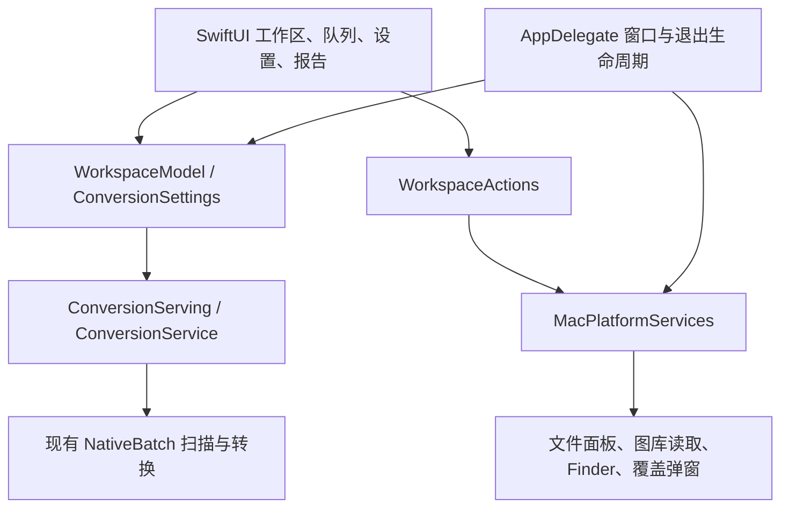

# SwiftUI 主界面实现

当前版本 1.3.1，最低 macOS 12，使用 Command Line Tools 构建。SwiftUI 工作区复用原生媒体引擎，平台服务负责图库读取、Live Photo 入册与系统共享。个人素材与生成报告保存在忽略提交的本地目录。

1.3.1 支持手动追加文件、文件夹与图库照片，并保留输出位置、导出设置和已有照片的封面选择。清空列表只重置当前任务，不删除原片、转换结果或图库资产。

## 当前界面

- 单一工作台：顶部放转换方向与导出设置，下方依次放添加照片、保存到和适用的目标手机。原生红黄绿按钮保留，标题文字隐藏，品牌图标位于融合标题栏右侧；顶部预留 28 点避免遮挡窗口控件。分段控件保留辅助功能名称；最近结果与停止监测保留在底部。
- 文件夹／相册弹窗从当前设置面板发起时，以该面板为父窗口；避免主窗口已有 sheet 导致请求被忽略，或新 sheet 排队至设置关闭后才出现。权限回调同时检查当前窗口及任务状态。参考 [Apple NSWindow sheet 管理](https://developer.apple.com/documentation/appkit/nswindow/sheets)和 [beginSheet 的排队行为](https://developer.apple.com/documentation/appkit/nswindow/beginsheet(_:completionhandler:))；本次未运行原生弹窗验证。
- 「添加照片」使用系统常规尺寸的原生按钮、系统橙色强调色，无展开箭头；点击和 ⌘O 均在按钮下方打开两项系统菜单，提供文件／文件夹多选与系统图库扫描入口。方向始终以分段控件并列显示；目前开放已实现的两个方向。
- 添加照片和保存位置按钮显示当前来源与输出摘要，菜单保留继续添加、更改位置等操作；完整路径可通过提示或复制查看。手动选择来源使用追加语义，同一图库照片的相同版本会去重；自动监测沿用替换语义。
- 队列常驻可转换、全部、静态照片、已完成、需检查五类筛选与完整来源计数；默认显示可转换，换来源时恢复此默认值，筛选仅影响展示。默认主按钮保持具体转换动作名称。宽窗口支持网格／列表，紧凑窗口使用两行列表。照片工具栏提供清空列表操作，任务进行时禁用。
- 设置统一从「导出设置」打开 sheet。预览是独立开关，默认关闭，并遵守当前照片分类；宽窗口显示可拖动分栏，较窄窗口以预览替换照片内容。照片旁提供可见的封面选择入口。网格仅加载缩略图，转换中暂停动态预览。
- 最小内容区为主窗口 720×600、图库 640×520、最近结果 560×500、报告 480×420 点。队列、设置、详情分别滚动；图库切换范围会清空旧选择，最近结果的查看与重试操作固定在底部。
- 原生按钮、Picker、复选框、Slider、DisclosureGroup、ProgressView；语义背景和文字颜色，无 Liquid Glass。
- 结果报告可筛选成功／已有／跳过／失败，查看和复制详情；关闭 JSON 时仍可读取内存报告。
- 菜单快捷键：⌘O 添加来源弹窗、⌥⌘P 预览、⌘R 重新扫描、⌘Return 开始、⌘. 停止、⌘, 导出设置。Return 不在整个工作区无条件启动转换。

## 代码边界



| 文件 | 职责 |
| --- | --- |
| `gui/ConversionSettings.swift` | 类型化设置、默认值、厂商和格式约束、引擎参数映射 |
| `gui/WorkspaceModel.swift` | 主线程可观察状态、任务快照、稳定行标识、过期回调过滤、报告转换 |
| `gui/ConversionService.swift` | 后台扫描／转换、主线程回调、可取消的覆盖决策等待 |
| `gui/WorkspaceView.swift` | 操作栏、摘要、工作区、状态栏，依可用宽高调整布局 |
| `gui/PhotoQueueView.swift` | 网格／列表、常驻分类、可选预览、选中详情与拖放入口 |
| `gui/ExportSettingsView.swift` | 分组设置与 sheet 绑定 |
| `gui/ReportView.swift` | 报告列表、筛选与可复制详情 |
| `gui/InterfaceSupport.swift` | 平台动作接口、系统色、布局规则、状态标签 |
| `gui/MacPlatformServices.swift` | macOS 原生弹窗、文件和图库选择、临时资源所有权、结果打开 |
| `gui/App.swift` | AppKit 应用宿主、原生菜单、窗口关闭／退出保护 |
| `gui/PhotosLibraryPicker.swift` | 按相册、方向和版本选择图库资源，下载和监测需启用 |
| `gui/PhotoLibraryService.swift` | 原始资源读取、实况入库、相册关联和增量观察 |
| `gui/DeliveryModels.swift` | 持久任务、校验摘要、去重、共享暂存和缓存保护 |
| `gui/SystemSharingService.swift` | 完整文件 URL 的系统共享与交付状态 |
| `gui/UISnapshotSupport.swift` | 仅诊断构建包含的虚构数据截图与连续缩放检查 |

同步媒体工作始终在后台执行。来源和参数在开始时形成快照，忙碌时禁止修改；每次操作持有独立 ID，旧任务回调不能覆盖新任务。停止先取消令牌，等待引擎清理，再允许新任务。覆盖决策等待可被令牌取消解除，不依赖弹窗一定返回。扫描分批回传，完整扫描完成后才可启动；`ConversionJob` 携带扫描快照，静态项跳过转换，媒体工作使用有数量和估算内存额度限制的工作池。扫描快照仅在批次内复用；来源清单或文件版本变化时必须重新检查。

图库默认读取未修改原片，可明确选择完整编辑版；不混用或自动回退不同版本的配对。读取临时资源由 Mac 平台服务持有，退出时清理。转换后的任务缓存、交付文件和去重记录持久保存，可在最近结果中查看、重试交付与清理，不随 View 或应用退出删除。

## 后续 iOS 适配

可复用 `ConversionSettings`、`WorkspaceModel`、服务协议以及大部分 SwiftUI 队列／设置／报告组件。共享模型和视图不导入 AppKit；背景色、Escape 行为采用条件编译。`WorkspaceActions` 由宿主注入选择文件、图库、打开结果、复制和拖放等操作。

iOS 仍需新建 target，提供平台文件导入／导出、security-scoped URL、图库权限、后台任务与取消策略。需要逐项核对底层媒体 API 可用性与打包，不能因 SwiftUI 视图可共享就认定整个引擎已通过 iOS 验证。Mac 的紧凑窗口布局是复用基础，iPhone 的导航、安全区、触控尺寸和 sheet 展示仍需单独适配。

## 构建与验证

```bash
# 默认仅 Intel .app，无 ZIP / DMG
bash scripts/build_app.sh

# 用户请求安装包时，生成匹配版本和架构的 DMG / ZIP
bash scripts/make_dmg.sh

# 只有明确需要其他架构时使用
bash scripts/build_app.sh --arm64
bash scripts/build_app.sh --universal

# 状态、取消、参数快照、真实双向转换、覆盖决策和原片保护
python3 scripts/check_workspace.py

# 原生窗口的虚构数据检查，不访问照片图库
bash scripts/build_app.sh --diagnostics
python3 scripts/check_swiftui_ui.py

# 引擎已有回归
bash scripts/build_gui_tests.sh
python3 scripts/check_gui_engine.py
```

诊断包写入 `.build/gui/preview/MomentStays.app`，正式包写入 `dist/MomentStays.app`。诊断截图与几何数据位于 `.build/gui/ui-checks/`；正式包不编入示例注入和截图入口。系统图标打包、媒体编码和窗口服务需要正常 macOS 桌面访问权限。

界面检查覆盖宽、中、窄、低高度、深色反向设置、设置 sheet、进度、空队列、千行队列和连续跨断点缩放。几何检查证明主要操作与列表处于可见范围，不能替代 VoiceOver、真实键盘操作、实际图库权限或 ARM/iOS 真机验收。
