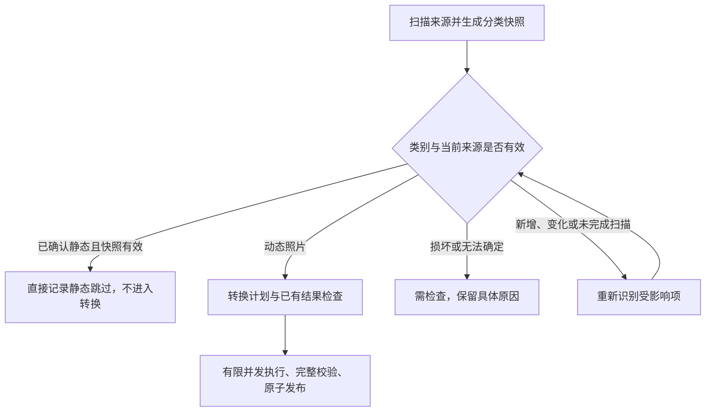

# Swift 引擎性能优化方案

状态：2026-10-27 已接入首批实现，后续优化分阶段推进。用户已要求按设备性能并行处理，并指出转换阶段仍遍历静态照片。本方案优先消除无效工作，再增加并发；不预设 Rust 重写，也不承诺未经实测的提速倍数。

关联：[新增功能需求](../product/并行处理、辅助照片EXIF与安卓互转.md)、[队列分类需求](../product/照片队列分类与状态展示.md)。本次整合接入任务计划、有限并发和初步计时；范围缓冲、跨阶段分析复用和更深入资源调度仍按后续阶段执行。

后续实测与图库专项复查见 [性能复查与并发调优](性能复查与并发调优.md)。

## 本次整合范围

- `ScanRow` 明确记录静态分类和批次内来源版本，版本包含设备、inode、大小、修改与变更时间；不把 `notMotion` 文案直接作为静态证明。JPEG/HEIC 结构、动态声明和图像尺寸仍需通过检查。
- `ConversionJob` 携带完整扫描队列。转换时保留原来源根目录，核对当前文件清单；新增或删除项目要求重扫，版本变化的文件重新识别。扫描中止后不能直接转换不完整清单。
- 有效静态项在覆盖询问、转换、转换专用源哈希和暂存目录之前跳过，独立计数，不占媒体转换进度。报告仍包含全部已处理来源。
- 两个方向的扫描采用固定数量工作线程，分批回传结果并稳定汇总；转换采用最多两个文件的保守默认并发。上限参考活动 CPU 和物理内存，高热状态退回串行；在途工作按文件大小和候选类型估算额度，超大文件独占额度。
- 覆盖决策串行，结果汇总串行；目标路径提前检查冲突。取消停止派发、等待在途清理，并保留已经发布的成功结果，最终报告及交付仅汇总一次。
- 报告记录枚举、计划、单文件执行和覆盖等待时间；部分转换阶段记录源哈希、解析、重封装及验证发布时间。`peak_in_flight` 为实际文件在途峰值，`peak_reserved_bytes` 为调度估算额度，不能当作实测内存。
- 网格改用静态缩略图，动态预览由用户主动展开；转换中暂停动态预览准备。深层共享解码预算、动态内存压力降级、候选分析复用和零拷贝缓冲尚未实现。

验证入口：`scripts/check_workspace.py`、`scripts/check_gui_engine.py`、`scripts/check_existing_output.py`、`scripts/check_multi_import.py`。`scripts/check_batch_performance.py` 使用 8 张带音频的合成动态 JPEG 和 24 张静态 JPEG，对比串行与自动并发并检查媒体和时间线一致性，输出 `.build/gui/batch-performance.json`。该小型负载不能替代大文件、HEIC、HDR、多候选和真实低内存设备基线；正式吞吐目标与默认参数进一步调优仍待这些测量。

本次验证已通过 103 项工作台状态／取消／真实双向集成检查、32 项原有媒体引擎检查、多来源同名映射与续转、覆盖失败回滚及候选封面导出。6 轮串行／自动并发合成测试媒体一致，测试时存在其他本机负载，不作为正式提速结论。

以下保留完整分阶段规划；其中建议不应被理解为已经全部完成。

## 1. 实施前确认的问题

- [WorkspaceModel.start](../../gui/WorkspaceModel.swift) 只把来源 URL 和设置传入 `ConversionJob`，未传递扫描分类或扫描批次清单。
- [NativeBatch.run](../../native/BatchEngine.swift) 再次枚举目录，对每个 JPEG/HEIC 构造目标并进入转换。普通静态图会经过源文件哈希和完整解析，直到被判为非动态后才跳过；已有目标存在时甚至可能先触发覆盖询问。
- [ConversionService](../../gui/ConversionService.swift) 使用串行工作队列，引擎也逐文件循环；文件级吞吐受串行执行限制。
- 解析链多处使用完整文件读取及 `[UInt8]` 数组切片/拼装；转换还执行多轮媒体与文件校验，需区分必要验证与可复用分析。
- [候选照片导出](../../native/CoverCandidates.swift) 涉及真实解码和 JPEG 编码；每张候选另存实况时，会分别重封装及校验配对视频。
- [预览控制器](../../gui/PhotoTimelineView.swift) 在动态照片视图出现时准备预览，可能与批处理争用磁盘、解码和内存。

以上来自静态检查，不是性能测量结论。磁盘吞吐、系统媒体框架及解析开销占比仍需基线验证。

## 2. 第一优先级：转换前剔除已确认的静态照片

### 目标流程

首次识别仍需要读取足够的文件结构；目标是避免扫描已确认静态后，在点击转换时再完整处理一次。不能仅按扩展名、文件大小或名字预判动态类型。

建议新增独立的任务计划，由来源批次快照构建，包含稳定源标识、相对目录、明确分类、扫描有效性信息和必要错误。任务计划覆盖全部来源，实际转换工作集合排除确认静态项；与用户当前 UI 筛选无关。

- 静态项不调用单文件转换、不计算转换专用源哈希、不提取视频、不创建输出暂存目录、不询问已有输出。
- 报告直接记录「静态照片，已跳过」，保留来源清单、跳过统计和队列分类，不为静态照片重新做媒体校验。
- 不可只过滤 `isMotion == false`，也不可只依赖当前字符串 `PhotoFormat.notMotion`：其文案为「不是受支持的动态照片」，不足以单独证明一定是普通静态图。需建立明确的静态、受支持动态、损坏/未知分类。
- 已知无法处理的来源保留具体错误，不混入静态跳过；当前参数可解决的条件项应重新评估。静态无效工作优化不意味着自动排除所有需检查项。
- 将目录根路径与相对路径映射保存在计划中，不能只把动态文件 URL 传回现有 `selection` 就导致共同根目录改变、输出位置漂移或续转找不到旧结果。
- 扫描未完成或已取消时，不把尚未识别的文件默认为静态；先补扫描或明确提示用户完成识别。
- 源文件新增、删除、替换或相关设置改变时，按失效规则重新识别受影响项。文件标识、大小和修改时间可用于快速失效判断，但不是内容相同的密码学证明；没有可信复用条件时回退识别，不长期仅按路径缓存静态结论。
- 目录变化处理建议采用明确批次快照并轻量检查变化，新增来源提示重扫；具体交互待实施核对，不在转换后台静默改变用户已看到的任务范围。
- 动态结果的源变化检查、输出回读和发布前校验全部保留。

### 计数与验收

例如来源中 100 张照片、其中 90 张确认静态且 10 张进入动态转换：界面显示「转换 0/10；90 张静态已跳过」，完成时报告保留全部 100 张的去向。静态跳过不推动动态转换进度，也不计为转换失败。

使用调用计数或事件记录证明：有效扫描后，确认静态项没有进入转换、哈希或视频处理入口，也未出现覆盖询问。允许为快照失效判断读取轻量文件属性；不能把“零转换调用”夸大为任何情况下零磁盘访问。

同时覆盖：全静态批次、静态占多数、同名目录、扫描后静态被替换成动态、目录新增、取消扫描、未知格式和损坏文件。全静态批次提示「没有待转换的动态照片」，不制造一次虚假的转换进度。

## 3. 建立可比较的性能基线

与第一阶段一起加入阶段计时和计数，记录枚举、识别解析、来源哈希、媒体分析、重封装、HDR/候选编码、输出校验及发布耗时。等待用户覆盖决策和 iCloud 下载分别统计，不混入引擎执行速度。

代表性数据集包括：静态占多数、普通动态 JPEG、三星 HEIC、HDR 转换、少量大文件、大批小文件、全部候选实况。先使用本地文件，图库和共享作为独立交付性能测试。

固定机器、构建优化级别、输入与输出介质，重复运行，区分首次与热缓存。记录总耗时、文件吞吐、阶段分布、进程峰值内存、在途数、逻辑读写量和错误数量；逻辑读取计数不等同于物理磁盘读取量。

## 4. 第二阶段：有限并行扫描，再并行转换

- 扫描先并行到独立结果，串行聚合和稳定排序；增量更新 UI，但不自动开始转换。
- 转换使用有上限的工作池，按 CPU、内存预算、文件大小及任务类型分配额度。普通重封装、HDR 编码和候选解码不同成本；预览纳入共享资源预算。
- 初始并发参数通过小规模基准决定，不按核心数无条件开满；低内存、大文件或磁盘饱和时减小并发。
- 每个文件独享媒体对象和暂存目录，目标路径先登记。覆盖弹窗串行，统计与结果聚合线程安全；完成进度由完成数量计算。
- 停止后停止派发，等待在途文件清理；最终报告与共享/图库交付仅触发一次。保留单文件原子发布和旧结果保护。

此阶段复杂度中高，核心风险是数据竞争、取消死锁、内存峰值和已有输出决策。不能只把现有 for 循环替换成并发循环。

## 5. 第三阶段：减少数据搬运和重复分析

- 逐步用一个受控的只读数据缓冲及范围引用描述静态图、增益图与内嵌视频，在需要独立修改或写出时才复制；保留所有越界和重叠检查。
- 不将 mmap 等同于一定更快或绝对不可变：来源可被外部修改，缓冲和文件生命周期必须受控；选用前分别测大文件和小文件。
- 在同一不可变输入与同一参数上下文中复用已验证的格式索引、轨道信息和源样本摘要；源变化即失效。首轮不跨任务缓存大块原始媒体。
- `hashFile` 已经按 1 MiB 分块读取，不再把“改成流式哈希”列为待实现优化。重点检查重复读取与数据转换，发布前独立输出回读及来源变化检查仍保留。
- 不为提速取消输出 SHA256、逐样本 PTS、音视频压缩数据和封面回读验证；相同源摘要可复用与验证独立输出是两件事。

范围引用和解析接口调整复杂度中高，按 JPEG、HEIC 分批实施，避免一次改动所有容器路径。

## 6. 第四阶段：候选照片与预览优化

- 预览采用按需准备与有限预取，离屏、来源变化或停止请求时取消过期工作；转换繁忙时减少预览资源占用，保持用户主动预览可响应。
- 缓存设置成本上限，键包含源版本和影响预览的参数；不能只按 URL 复用过期画面。
- 同一来源的多个候选复用可验证的轨道分析和候选索引，减少反复读取主视频；分别测解码与 JPEG 编码成本。
- 多张候选实况可研究复用源媒体分析，但各输出仍须有自己的配对标识、封面定时信息和独立输出校验。不能直接硬链接同一个 MOV 冒充多个封面不同的配对。
- 不缓存全部候选的完整解码图像；辅助照片 EXIF 继承与编码流程一起接入，保持方向、色彩和字段准确。

## 7. 新增安卓互转的约束

新增方向直接使用已验证静态载荷与主视频组装目标，不通过可见的 Apple 配对中转。复用上述计划、资源调度、取消和验证机制，而不是复制第三套批处理循环。

避免不必要的视频重封装，但只有证明目标容器和时序允许直接保留时才复用；辅助轨及私有 HDR 的保留边界仍按产品需求明确处理，不能用“优化”解释数据丢失。

## 8. 交付顺序、收益与 Rust 评估

| 顺序 | 可独立交付内容 | 预期收益与不确定性 |
| --- | --- | --- |
| P0 | 阶段计时、任务计划、确认静态提前跳过 | 混合批次直接减少无效转换工作；收益随静态占比变化，不消除首次识别 |
| P1 | 并行扫描、稳定汇总、增量显示 | 多文件更早看到结果；受 I/O 和完整识别成本限制 |
| P2 | 受资源预算约束的文件级并行 | 提高批次吞吐；单文件延迟不保证下降 |
| P3 | 范围缓冲、重复分析复用 | 降低复制与内存压力，支持更稳的并行；收益需阶段测量 |
| P4 | 候选实况与预览共享预算优化 | 重点改善多候选和网格预览场景，普通转换可能收益较少 |

每阶段对比前一基线并跑相关正确性回归；同一来源的媒体内容、样本数、PTS、封面及 HDR 结果一致，UUID 与任务时间不同不要求整体文件哈希相同。错误、取消、覆盖和来源保护不得退化。

正式吞吐和内存目标在基线测量后确定。目前不写入“提升两倍”等承诺；如任一优化没有收益或明显加大资源压力，应缩减或回退该策略。

Rust 保留为后续热点实验：若完成上述优化后，剖析仍显示自有解析/字节处理占主要耗时，再选择一个热点做功能等价的 Swift/Rust 对照。评价端到端耗时、峰值内存、跨语言复制和维护成本，不只比较微基准。未证实瓶颈前不进行整体重写。

后续调试只默认 Intel，不生成 ARM、通用二进制、DMG 或 ZIP，除非用户明确要求。
